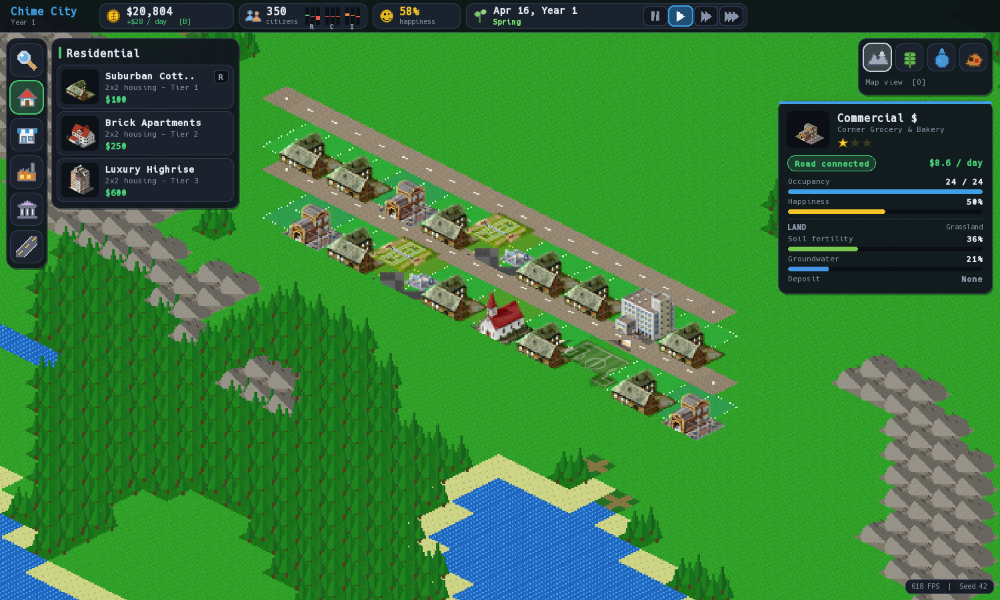
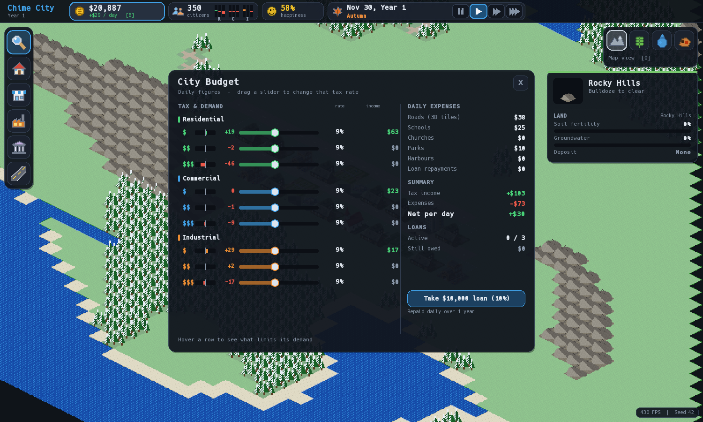

# Chime V2: 2D Isometric City Builder

A 2D isometric city builder in **C++17** with **SFML 2.6.1** and **CMake**, inspired by mobile city builders such as TheoTown.

Every game starts on a procedurally generated 64×64 island. Build roads, homes, shops, industry and farms. Fund schools, churches and parks. Keep the budget in the black through the seasons.



---

## Features

- **Procedural worlds:** seeded terrain with ocean coastlines, lakes, rivers, beaches, forests with trails and rocky hills. Each tile also has soil fertility, groundwater and coal / iron / stone deposits. The same seed always gives the same map.
- **Zones:** drag to paint residential, commercial or industrial zones in low, medium or high density. Buildings grow on zoned land next to roads while there is demand, and upgrade up to the tier the density allows. You can also place a specific building by hand; placed buildings keep their tier.
- **Demand by income level:** residential, commercial and industrial demand is tracked separately for low ($), medium ($$) and high ($$$) income. Buildings only fill with people while their income level has demand.
- **Economy:** nine tax sliders, one per sector and income level. Daily tax income, daily upkeep for roads and services, loans, and bankruptcy after 6 months in debt.
- **Time and seasons:** pause, 1x, 2x or 4x speed and a 360-day calendar. Seasons change the look of the map: autumn forests, winter snow. Farms also produce more or less by season.
- **Services and happiness:** schools, churches and parks cover nearby homes. Happiness depends on jobs, education, health, safety and taxes.
- **Roads & traffic:** dirt, asphalt and avenue tiers with drag-to-upgrade, autotiled corners / T-junctions / crossings, bridges, roundabouts, an outside connection at the map edge, and a daily commute model whose jams cost happiness. Cars drive the busiest routes.
- **Power & water:** coal, wind and solar plants feed the grid through roads or dragged power lines, and water travels through roads or underground pipes, so plants and pumps can stand away from the road; transformers step the power down for the buildings on their grid. Wells and underground pumps draw on the groundwater reserve, which drains as you pump and recharges slowly; treatment plants clean pump water and towers store spare water. Demand grows with population, building tier and city size, and from 150 citizens on, unserved buildings stop growing and shrink.
- **City services:** police (safety), fire stations (fires can break out and spread in bigger towns), clinics (health), bus depots (fewer cars, with buses on the roads) and mines on coal / iron / stone deposits.
- **Waste and sewage:** garbage has to go somewhere: landfills fill up for good, incinerators burn it (polluting, but they make power) and recycling centres handle it cleanly. Waste water needs a sewage outflow into a lake or the sea (polluting) or a treatment plant.
- **Land value:** parks, schools, shops, services and water raise it; pollution and jams lower it. Buildings need it to upgrade.
- **Menus and progression:** a title screen, pause menu, difficulty choice and settings. The city climbs from Settlement to Metropolis, and each rank needs enough people, enough happiness and the right services (power, water, garbage, then schools, police, fire, health, then sewers, buses, education and land value). Each rank pays a bonus and unlocks buildings; the Rank tab (`G`) shows the checklist, and tips guide a new mayor.
- **Looks:** four variants per building tier, a day / night cycle with lit windows and street lights, and a clickable minimap (`M`).
- **Trade:** industry and farms produce goods and food; the surplus is exported over roads leaving the map and through harbours, shortages are imported.
- **Statistics and sound:** `G` shows graphs of population, money, happiness, demand and trade; synthesised sound effects and city ambience.
- **Save, load and undo:** `F5` saves, `F9` loads, the city autosaves monthly and on exit, and `Z` undoes the last build. `L` opens the message log.
- **Interface:** sidebar build menu with building thumbnails and prices, status bar, budget panel, inspect card, map views for fertility, groundwater, deposits, traffic, and power and water (showing every line and pipe). The window can be resized freely.



---

## Build and run

**Requirements:** a MinGW / GCC compiler with C++17 support, and CMake 3.20 or newer. SFML 2.6.1 is used from the bundled `SFML/` folder or downloaded automatically.

```powershell
# Configure
cmake -S . -B build -G "MinGW Makefiles"

# Build the game and the test runner
cmake --build build

# Run the tests (107)
.\build\citybuilder_tests.exe
# or: ctest --test-dir build --output-on-failure

# Play
.\build\citybuilder.exe
```

The build copies the SFML DLLs, the font and all sprites into `build/`.

---

## How to play

1. Lay **roads** (`Space`, drag to draw) and run one to the **map edge** for an outside connection. Buildings only work when a road runs along one of their edges.
2. Place **homes** (`R`), then **shops** (`C`) and **industry** (`I`) to give residents jobs. Watch the 9 demand bars in the top bar.
3. Add a **school** (`1`) so medium- and high-income residents will move in, and **parks** (`3`) to keep people healthy.
4. Open the **budget** (`B`) to check income against upkeep and adjust taxes. Stay out of debt for long, or the city goes bankrupt.

### Controls

| Input | Action |
|---|---|
| **Left sidebar** | Pick a category, then a building card |
| **Left click / drag** | Build; drag to draw roads or fill areas |
| **Right click** / `Esc` | Cancel the drag or tool; `Esc` also closes the budget |
| `W` `A` `S` `D` / arrows | Pan the camera (`Shift` = faster) |
| `Q` / `E` (or `+` / `-`) | Zoom in / out |
| `R` `C` `I` `F` | Low-density Residential / Commercial / Industrial zone, Farm |
| `1` `2` `3` `H` | School, Church, Park, Harbour |
| `Space` `W` `X` | Road, Water, Demolish |
| `U` | Power & water buildings |
| `P`, `[`, `]` | Pause, slower, faster (or use the top-bar buttons) |
| `B` | Budget (or click the money chip) |
| `O` | Map view: Normal, Fertility, Groundwater, Deposits, Traffic, Power, Water, Land value |
| `F5` / `F9` | Save / load (`city.sav`; the autosave if there is none) |
| `Z` | Undo the last build |
| `L` | Message log |
| `G` | Statistics (incl. the rank checklist) |
| `M` | Minimap |
| `Esc` | Pause menu (when no tool is selected) |
| `N` | Found a new city after bankruptcy |

### Launch options

| Option | Purpose |
|---|---|
| `--seed N` | Replay a specific world (the seed is shown bottom-right) |
| `--size WxH` | Starting window size, e.g. `--size 1920x1080` |
| `--month N` | Start in month N, e.g. `--month 1` for winter |
| `--starter` | Start in a ready-made showcase town with every road, utility and service type |
| `--load file.sav` | Open a saved city |

Developer options (benchmarks, balance simulation, screenshots) are listed in [agents.md](agents.md).

---

## Project layout

```
cpp-2d-citybuilder/
├── main.cpp                 # Entry point and launch options
├── src/                     # Engine: window, game loop, assets, globals
├── game/
│   ├── scenes/              # Play_Scene: input, building, rendering, HUD
│   ├── entities/            # Zones (R/C/I, farm, civics, harbour), roads
│   ├── world/               # World data, generator, batched ground renderer
│   ├── simulation/          # Economy, game clock, happiness
│   └── ui/                  # UI kit, build menu
├── assets/sprites/          # Pixel-art sprites and UI icons
├── tools/                   # Python sprite / icon generators
├── tests/                   # Test framework and 107 tests
└── docs/                    # Gameplay and simulation guide
```

## Documentation

- [docs/THEOTOWN_SIMULATION_GUIDE.md](docs/THEOTOWN_SIMULATION_GUIDE.md): gameplay mechanics, buildings, economy formulas, seasons and world generation.
- [agents.md](agents.md): architecture, conventions and developer tooling for contributors and coding agents.
